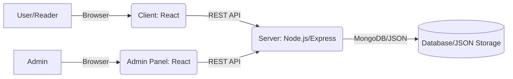

<!--
  MeroKhabar README
  Interactive, detailed, and visually engaging documentation inspired by modern documentation standards.
-->

<p align="center">
  
</p>

<h1 align="center">📰 MeroKhabar</h1>
<p align="center">
  <b>Your Personalized News Publishing & Reading Platform</b><br/>
  <i>Read, manage, and publish the latest news with ease. Built for newsrooms, bloggers, and curious readers alike.</i>
</p>

<p align="center">
  <a href="#features">Features</a> •
  <a href="#architecture">Architecture</a> •
  <a href="#getting-started">Getting Started</a> •
  <a href="#user-flows">User Flows</a> •
  <a href="#file-structure">File Structure</a> •
  <a href="#faq">FAQ</a> •
  <a href="#contributing">Contributing</a>
</p>

---

<div align="center">


</div>

---

## ✨ Features

<div align="center">

| 🗞 News Reading        | 🛠 Admin Dashboard        | 📦 JSON/MongoDB Storage   | 🎨 Modern UI/UX         | 🔒 Role-based Access      |
|-----------------------|--------------------------|--------------------------|-------------------------|--------------------------|
| Browse articles, categories, trending & featured | Create, edit, delete articles & categories | Flexible storage: JSON & MongoDB support | Clean, responsive, mobile-ready | Admin authentication, user management |

</div>

- **News Portal (Client):**
  - Browse, search, and read the latest articles by category, popularity, or featured status.
  - Responsive, accessible, and fast news experience for readers.
  - Trending, latest, and editor’s pick sections for dynamic storytelling.
  - Built-in search and category filtering.
  - Shareable links for every story.

- **Admin Dashboard:**
  - Secure login for admin users.
  - Create, edit, delete, and manage news articles, categories, and user roles.
  - Analytics for articles, users, total views, and engagement.
  - Advanced moderation: trash, restore, review reported content, manage comments and notifications.
  - Quick publishing tools and content status (featured/standard).

- **API Backend:**
  - RESTful endpoints for articles, categories, comments, and users.
  - Built with Express.js and MongoDB (with legacy JSON file support for rapid prototyping).
  - Robust error handling and logging.
  - Modular routes for easy feature expansion.

- **User Management & Security:**
  - Admin-only dashboard protected by authentication.
  - Role-based access—expandable for future user registration and reader logins.
  - All sensitive actions require authentication.

- **Tech & Developer Experience:**
  - Modular React component structure for both admin and client.
  - Context API for state management.
  - Clean CSS for maintainable, responsive design.
  - Easily extensible with new modules, themes, or integrations.

---

## 🏗 Architecture



- **Client** (`client/`):  
  Public-facing news portal for browsing, searching, and reading articles. Built with React.js and Context API.

- **Admin Panel** (`admin/`):  
  Secure dashboard for admins to manage all news content and users. Built with React.js, Context API, and modular components.

- **Server API** (`server/`):  
  Node.js + Express backend serving both client and admin panel. Connects to MongoDB (preferred) or JSON files for storage.

- **Database** (`server/models/`, `server/data/`):  
  Uses MongoDB collections for Articles, Categories, and Users.  
  Legacy support for JSON file storage for quick setup or small deployments.

---

## 🚦 Getting Started

### Prerequisites

- **Node.js** (v16+ recommended)
- **npm** or **yarn**

### Local Installation

```sh
# 1. Clone the repository
git clone https://github.com/the-abhishekroy/MeroKhabar.git
cd MeroKhabar

# 2. Install dependencies for all modules
cd admin && npm install
cd ../client && npm install
cd ../server && npm install

# 3. Configure environment variables
# (For MongoDB: create .env in server/ with MONGO_URI)

# 4. Run the backend server
cd ../server
npm start

# 5. Run the admin dashboard
cd ../admin
npm start

# 6. Run the client (news portal)
cd ../client
npm start
```

- Admin panel: [http://localhost:3001](http://localhost:3001)
- Client (news site): [http://localhost:3000](http://localhost:3000)
- Backend server: [http://localhost:3002](http://localhost:3002)

---

## 🧑‍💻 User Flows

### For Readers

1. **Visit the News Portal:**  
   - Instantly browse the latest headlines, trending stories, and categories.
   - Use search and filters to find content that matters to you.
   - Click on any article to read full details, date, author, and category.
   - Share stories via social links.

2. **Explore Categories:**  
   - Select from curated news categories for focused reading.
   - Featured, trending, and editor’s picks always visible.

### For Admins

1. **Login to Admin Panel:**  
   - Secure sign-in for authorized editors and admins.

2. **Article Management:**  
   - Create new articles with title, content, category, author, and status.
   - Edit, delete, or feature articles with a single click.
   - Search, filter, and sort articles by newest, oldest, or category.
   - Moderate reported content, comments, and notifications.

3. **Category & User Management:**  
   - Add or modify news categories on the fly.
   - Manage user roles and permissions (expandable for future reader accounts).

4. **Analytics & Moderation:**  
   - See stats: total articles, users, views, and engagement.
   - Quick links for publishing, trash, and restoring content.

---

## 📂 File Structure

```text
MeroKhabar/
│
├─ admin/         # Admin dashboard (React app)
│   ├─ public/
│   └─ src/
│       ├─ components/
│       ├─ contexts/
│       ├─ services/
│       └─ App.js
│
├─ client/        # Public news portal (React app)
│   ├─ public/
│   └─ src/
│       ├─ components/
│       ├─ pages/
│       ├─ services/
│       └─ App.js
│
├─ server/        # Node.js/Express backend
│   ├─ data/      # JSON file storage (legacy/support)
│   ├─ models/    # MongoDB schemas
│   ├─ routes/    # API endpoints
│   ├─ index.js   # Server entrypoint
│   └─ .env       # (Add your MONGO_URI here)
│
└─ README.md
```

---

## ❓ FAQ

**Q: Does MeroKhabar support both MongoDB and file-based storage?**  
A: Yes! By default, MongoDB is preferred (set `MONGO_URI` in your `.env`). If not provided, legacy JSON file storage is used.

**Q: Is authentication required for admins?**  
A: Absolutely. Only logged-in admins can access the dashboard and perform CRUD operations.

**Q: Can I add new features, themes, or integrations?**  
A: Definitely! The codebase is modular and easy to extend—fork and build your own features.

**Q: Can I use this for a multi-author blog or magazine?**  
A: Yes! User and role management is built-in and can be expanded for more complex scenarios.

**Q: How do I deploy this project?**  
A: You can deploy each module on separate servers, or containerize with Docker for more robust deployments. Heroku, Vercel, and other platforms are supported.

---

## 🤝 Contributing

We welcome contributions from everyone!  
- Fork the repository 🍴
- Create a branch (`git checkout -b feature-branch`) 🌿
- Commit changes (`git commit -m "Added new feature"`) ✅
- Push and open a Pull Request 🔥

---

## 📜 License

MIT License

---

<p align="center">
  
  <br/><b>MeroKhabar © 2025 by Abhishek Roy</b>
</p>
